<h2 data-importer="text" align="center">Hello there! I am Dimsum...</h2>

###

  
  

###

<h2 data-importer="text" align="center">Here are my socials...</h2>

###

 

  
  
  

###

<h2 data-importer="text" align="center">And these are what I am proficient at...</h2>

###

 

  
  
  
  
  
  
  
  
  
  
  
  
  
  
  
  
  
  
  
  
  

###

<h2 data-importer="text" align="left"></h2>

###

 

  

###

<h2 data-importer="text" align="center">Pacman Contributions</h2>

###

 

<picture data-importer="pacman">
  <source media="(prefers-color-scheme: dark)" srcset="https://raw.githubusercontent.com/DimasDFAR/DimasDFAR/pacman-output/pacman-contribution-graph-dark.svg?game=pacman">
  <source media="(prefers-color-scheme: light)" srcset="https://raw.githubusercontent.com/DimasDFAR/DimasDFAR/pacman-output/pacman-contribution-graph.svg?game=pacman">
  
</picture>

###